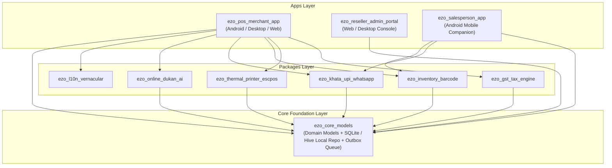
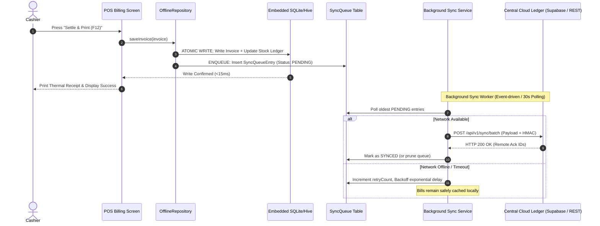

# BharatHisab POS Monorepo Architecture Blueprint

This document specifies the technical architecture, data flow, synchronization engine, and security boundaries of the **BharatHisab POS & Billing Flutter Monorepo**.

---

## 1. High-Level Architectural Pattern

The workspace adheres to **Domain-Driven Design (DDD)** and **Clean Architecture** principles across a Melos Flutter Monorepo. Business logic is decoupled into pure Dart packages, while presentation and platform bindings are isolated inside consumer apps.



---

## 2. Offline-First Storage & Outbox Synchronization Pipeline

Retail counters in India face frequent network drops, power fluctuations, and spotty Wi-Fi. BharatHisab guarantees **zero billing disruption** by implementing a local-first write pattern.

### 2.1 The Outbox Pattern (`SyncQueueEntry`)

Every mutation (new invoice, customer credit update, stock adjustment) is committed to the embedded local database (SQLite/Hive) in **< 15 milliseconds**. Simultaneously, a lightweight `SyncQueueEntry` is enqueued into the local sync outbox.



### 2.2 SyncQueue Data Contract

Each transaction enqueued carries full metadata for idempotent replay:

| Field | Type | Description |
|---|---|---|
| `id` | `String` | Client-generated UUIDv4 preventing duplicate server inserts. |
| `entityType` | `String` | Entity type: `invoice`, `party_account`, `product_stock`, `khata_entry`. |
| `operation` | `SyncOperation` | `create`, `update`, `delete`. |
| `payloadJson` | `String` | Complete canonical JSON snapshot of the entity. |
| `createdAt` | `DateTime` | UTC timestamp of client action. |
| `status` | `SyncStatus` | `pending`, `syncing`, `synced`, `failed`. |
| `retryCount` | `int` | Number of failed transmission attempts. |
| `lastError` | `String?` | Traceback of network or validation failure. |

### 2.3 Conflict Resolution Strategy: Last-Write-Wins with Ledger Immutability
- **Invoices**: Strictly immutable. Invoices are never updated; amendments are recorded as `salesReturnCreditNote` or `debitNote`.
- **Khata Ledger**: Append-only double-entry ledger. Balance is computed dynamically as:
  $$\text{Net Balance} = \text{Opening Balance} + \sum \text{Debit (You Gave)} - \sum \text{Credit (You Got)}$$
- **Stock Inventory**: Inventory movements use delta records (`StockMovementRecord`) rather than absolute overrides, preventing race conditions across multi-terminal stores.

---

## 3. Multi-Tenant Isolation & License Enforcement

BharatHisab POS is engineered for white-label multi-tenancy. A single codebase serves independent merchants, franchisors, and SaaS resellers.

### 3.1 Tenant Profile Data Model

Each tenant boundary is encapsulated in `BusinessProfile`:
- `id`: Unique Store UUID.
- `storeName`, `legalEntityName`, `gstin`, `stateCode`.
- `isGstEnabled`: Switches tax math between Regular GST vs Non-GST Bill of Supply.
- `defaultPrintFormat`: `58mm_chota`, `80mm_bada`, `a4_modern`, `a4_tally`, `a5`.
- `activeLanguageCode`: Selects from 10 vernacular languages.
- `WhiteLabelBranding`: Controls runtime UI colors, app titles, WhatsApp hotline, and receipt footer slogans without app recompilation.

### 3.2 License Quota Enforcement (`MerchantLicenseKey`)

Hardware and tenant capabilities are gated through cryptographically generated license strings (`EZO-{TIER}-{TIMESTAMP}`):

```dart
class MerchantLicenseKey {
  final String keyString;
  final String legalEntityName;
  final SubscriptionTier tier; // freeTrial, oneYearStandard, threeYearPro, lifetimeEnterprise
  final DateTime activatedAt;
  final DateTime expiresAt;
  final int maxAllowedStores;  // Branch limit (1 - 25)
  final int maxStaffSeats;     // Staff seat limit (2 - 50)
  final bool isDhandaAiEnabled;// Feature gate for Google AI
  final bool isOnlineDukanEnabled; // Feature gate for WhatsApp Store
}
```

The app evaluates `license.isValid` and `license.daysRemaining` on app startup and enforces hard blocks if expired or quotas are breached.

---

## 4. Role-Based Access Control (RBAC) & Authentication Lifecycle

### 4.1 Authentication Architecture & Clean-State Session Management

To ensure zero simulated or prototype data leaks into real production environments, the application enforces strict lifecycle controls:

1. **Merchant Onboarding (`MerchantAuthScreen`)**:
   - On initial launch, the system checks if any business profiles exist.
   - If empty, the app immediately routes to the 2-tab Merchant Auth Portal.
   - **No forced dummy data seeding** occurs without explicit user consent.
   - The user selects their exact Industry Vertical, State code, GST mode, and chooses whether to start with a **100% clean store (0 items)** or opt-in to starter demo staples.

2. **Cashier Shift Lock & Session Invalidation (`onLogout`)**:
   - Cashiers can lock their register via the top navigation bar avatar pill.
   - Shifts require the cashier's 4-digit PIN to resume billing operations.

3. **Danger Zone Slate Reset (`onResetAll`)**:
   - Available under Store Settings and the Cashier menu.
   - Executing a wipe atomically clears all SQLite/Hive tables (`clearAll()`) and redirects back to the account creation screen, enabling complete testing cycles.

4. **Superadmin & Field Companion Gates**:
   - **Superadmin Portal (`apps/ezo_reseller_admin_portal`)**: Gated via `SuperadminAuthScreen` requiring Master Admin credentials (`admin@bharathisab.com` / `889900`) or agency registration.
   - **Salesperson App (`apps/ezo_salesperson_app`)**: Gated via `SalespersonAuthScreen` requiring merchant shop association and field representative PIN.

### 4.2 RBAC Permission Matrix

To prevent cashier fraud and counter pilferage, BharatHisab enforces granular permissions across 4 staff tiers:

| Permission Flag | Counter Cashier (`counterCashier`) | Field Salesperson (`fieldSalesperson`) | Store Manager (`storeManager`) | Owner / Admin (`ownerAdmin`) |
|---|:---:|:---:|:---:|:---:|
| **Create POS Bills** | ✅ | ✅ | ✅ | ✅ |
| **Override Unit Selling Prices** | ❌ | ❌ | ✅ | ✅ |
| **Apply Bill-Level Discounts** | Up to 5% | ❌ | Up to 25% | Unlimited |
| **Delete or Void Invoices** | ❌ | ❌ | ❌ | ✅ |
| **View Gross Profit & Margins** | ❌ | ❌ | ❌ | ✅ |
| **Collect Khata Udhaar** | ✅ | ✅ | ✅ | ✅ |
| **Export GSTR Tax Reports** | ❌ | ❌ | ✅ | ✅ |
| **Change Store GSTIN / Profile** | ❌ | ❌ | ❌ | ✅ |
| **Issue Commercial Licenses** | ❌ | ❌ | ❌ | Reseller Portal Only |

---

## 5. Directory Structure & Monorepo Configuration

The monorepo is orchestrated via `melos.yaml`. All packages share dependencies, lint rules, and automated release cycles.

```yaml
name: ezo_pos_workspace
packages:
  - apps/**
  - packages/**
scripts:
  analyze:
    run: melos exec -- "flutter analyze . || dart analyze ."
  test:
    run: melos exec --dir-exists="test" -- "flutter test || dart test"
```

For package API specifications and usage guides, refer to [Packages API Reference](../packages/PACKAGES_API_REFERENCE.md).

---

## 6. Central Cloud Backend & Synchronized Offline-First Architecture

To eliminate device database sandboxing (where mobile and web apps could not share accounts or inventory), BharatHisab POS uses a hybrid client-cloud synchronization architecture:

```
+------------------------------------+        +-----------------------------------+
|  BharatHisab Android Mobile App    |        |   BharatHisab Merchant Web App    |
|   (SQLite / SharedPreferences)     |        |   (IndexedDB / LocalStorage)      |
+-----------------+------------------+        +-----------------+-----------------+
                  |                                             |
                  |  HTTP REST + PBKDF2 Auth & JSON Sync Push   |
                  +---------------------+-----------------------+
                                        |
                                        v
                       +---------------------------------+
                       |    Central Cloud Backend API    |
                       |       (Node.js / Express)       |
                       |  - PBKDF2-SHA256 Auth Hashing   |
                       |  - Rate-Limited PIN Auth        |
                       |  - Delta Sync Push & Pull       |
                       |  - Fleet Telemetry for Admin    |
                       +----------------+----------------+
                                        |
                                        v
                       +---------------------------------+
                       |   Superadmin & Reseller Tower   |
                       |    Live Fleet Telemetry (Poll)  |
                       +---------------------------------+
```

### Core Endpoints:
1. `POST /api/v1/auth/register`: Central registration that hashes PINs with unique 16-byte random salts using PBKDF2-SHA256 (10,000 iterations), provisions a commercial 3-year Pro license, and initializes a merchant tenancy.
2. `POST /api/v1/auth/login`: Authenticates store staff with rate-limiting protection (locks out IP + phone combinations exceeding 5 failed attempts for 5 minutes).
3. `POST /api/v1/sync/push`: Incremental sync of products, parties, invoices, and khata entries.
4. `GET /api/v1/sync/pull`: Fetches the latest cloud catalog and ledger state.
5. `GET /api/v1/admin/merchants`: Real-time fleet telemetry monitoring live tenant volume, transaction counts, and store health.
